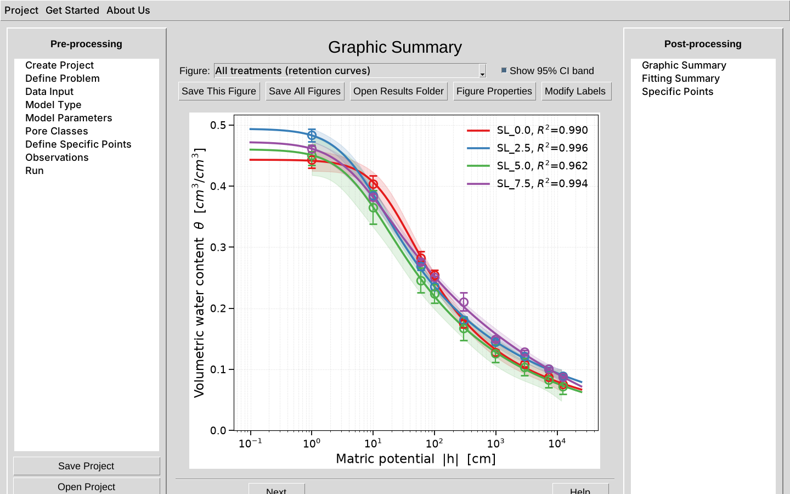
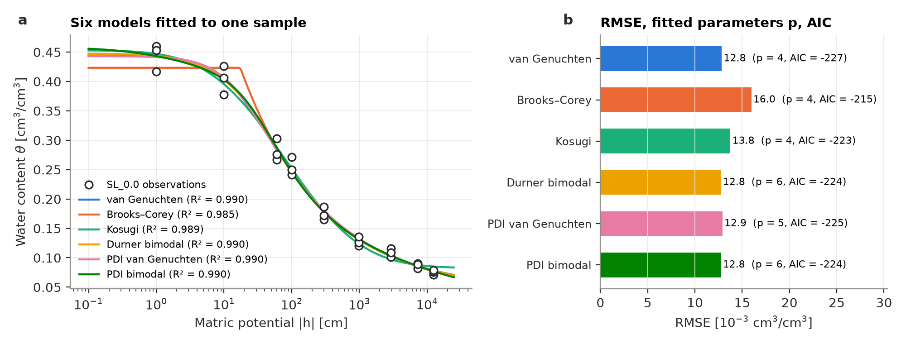
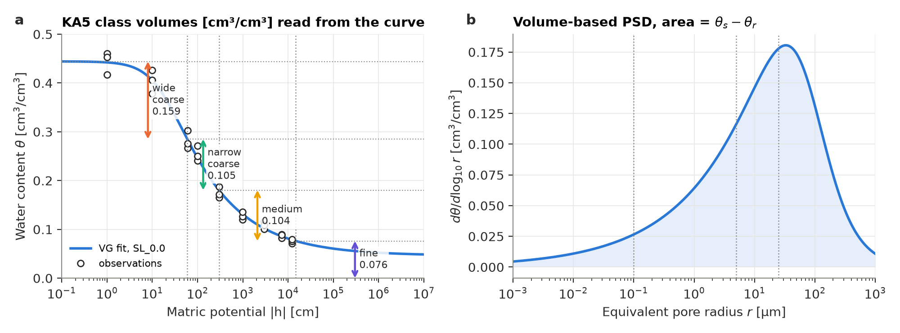
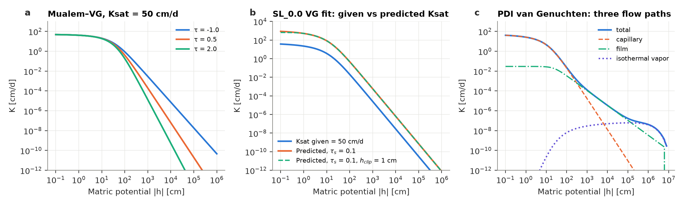
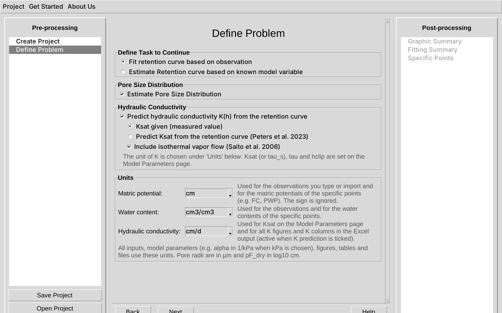

# SoPhyFit

**Soil water retention, pore sizes and hydraulic conductivity, with 95% confidence intervals.**

SoPhyFit (Soil Physics Fit) fits soil water retention curves to measured data and reports every derived quantity with a 95% confidence interval. It predicts the unsaturated hydraulic conductivity and the pore-size distribution from the fitted curve. It is a Windows desktop program with a step-by-step interface; no programming or Python installation is needed.

Developed at the [Chair of Soil Biophysics and Environmental Systems](https://www.lss.ls.tum.de/sbe/), Technical University of Munich.

## Features

- **Six retention models:** van Genuchten (1980), Brooks and Corey (1964), Kosugi (1996), bimodal van Genuchten (Durner, 1994), and the PDI variants of the unimodal and bimodal van Genuchten models for the dry range (Peters, 2013; Iden and Durner, 2014; Peters et al., 2024).
- **95% confidence intervals on every result:** parameters, the fitted curve, water content at given heads, plant-available water, matric potential at given water contents, pore-class volumes and conductivity.
- **Specific points:** field capacity, permanent wilting point, plant-available water content, and the matric potential at any water content.
- **Pore-size distribution and pore classes:** volume-based distribution from the Young–Laplace equation; KA5 pore classes or user-defined classes.
- **Hydraulic conductivity K(h):** Mualem (1976) model with a measured or predicted saturated conductivity (Peters et al., 2023), optional maximum pore size (h_clip), film flow (Peters et al., 2021) and isothermal vapor flow (Saito et al., 2006).
- **Free choice of units:** h in cm, hPa or kPa; θ in cm³/cm³ or %; K in cm/d, cm/h, mm/h, mm/d, m/d or m/s.
- **Batch processing:** all samples of a data set are fitted separately and compared in shared figures and one summary workbook.
- **Outputs:** publication-ready figures (PNG), Excel workbooks per sample and for all samples, and text reports.

## Screenshots

| Six models fitted to one sample | KA5 pore classes and pore-size distribution |
|---|---|
|  |  |

| Hydraulic conductivity predicted from the retention curve | Define Problem page |
|---|---|
|  |  |

## Download and install

1. Go to **[Releases](https://github.com/Tum-Soil-Biophysics/SoPhyFit/releases/latest)** and download `SoPhyFit_Setup_<version>.exe`.
2. Run the file and follow the setup wizard. No administrator rights are needed; the program installs for the current user.
3. Start SoPhyFit from the Start menu. Projects are saved to `Documents\SoPhyFit`.

Requirements: Windows 10 or 11, 64-bit.

## Updates

SoPhyFit checks for a new version each time it starts (this needs an internet connection; only the latest version number is requested from GitHub, no data is sent). You can also choose **Help → Check for Updates**. To update, download the new setup file and run it: it replaces the old version and keeps your projects.

To be notified by email, click **Watch → Custom → Releases** at the top of this page.

## Documentation

The **[User Guide (PDF)](docs/SoPhyFit_User_Guide.pdf)** explains the scientific background of every model and method, with figures, and how to use the program. It also opens from **Help → User Guide** in the program.

## How to cite

If you use SoPhyFit in your work, please cite it:

> Zarebanadkouki, M. (2026). SoPhyFit: soil water retention, pore sizes and hydraulic conductivity with 95% confidence intervals (Version 1.0.0) [Computer software]. Technical University of Munich. Zenodo. https://doi.org/[DOI]

Each release is archived on [Zenodo](https://zenodo.org/communities/tum-sbe) with its own DOI, listed at the end of the release notes. Cite the version you used. GitHub also shows a **"Cite this repository"** button with this citation in other formats.

## Feedback and bug reports

Please use **[Issues](https://github.com/Tum-Soil-Biophysics/SoPhyFit/issues)** to report a problem or suggest a feature.

## License

SoPhyFit is free to use for research and teaching. See [LICENSE.md](LICENSE.md) for the terms.
